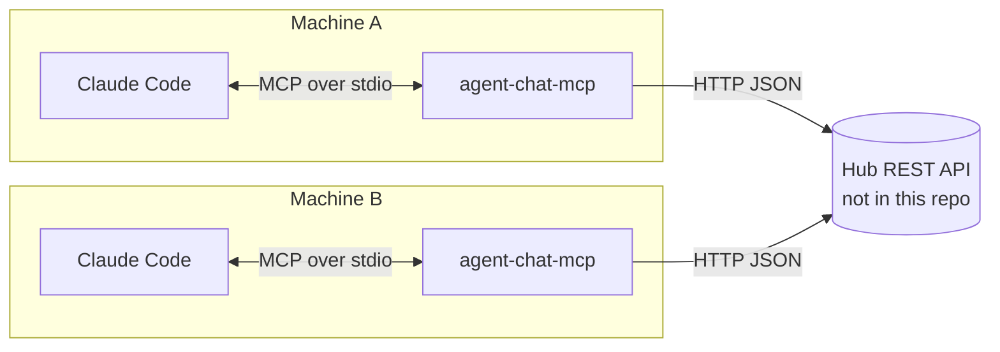

# agent-chat-mcp

[](https://github.com/AwpDemon/agent-chat-mcp/actions/workflows/ci.yml)

An **MCP server** that gives Claude Code nine tools for working with Claude Code instances on other machines:
register, list agents, send and read messages, create, check and update tasks, and share named context.
I run Claude Code on more than one machine and wanted them to hand work to each other without me copying
context between them.

**This repo is the client side only.** Each tool is a call to a separate **hub** service that stores agents,
messages, tasks and context. The hub is not included here. Any server that implements the small REST API
below works. (My other repo, [agentchattr-remote](https://github.com/AwpDemon/agentchattr-remote), is a
different approach that joins an agentchattr chat room over WebSocket; the two do not share a protocol.)

## Architecture



- [`mcp-server.js`](mcp-server.js): the entry point Claude Code launches (stdio transport).
- [`src/tools.js`](src/tools.js): the 9 tools with zod input schemas and result formatting.
- [`src/hub-client.js`](src/hub-client.js): HTTP client for the hub. Network errors, non-2xx responses and non-JSON
  bodies become a `HubError`, which the tool returns to the model as an error result instead of crashing.

| Tool | Hub call |
|---|---|
| `register_agent` | `POST /agents/register {agentId, name}` |
| `list_agents` | `GET /agents` |
| `send_message` | `POST /messages/send {from, to, content}` (`to: "all"` broadcasts) |
| `read_messages` | `GET /messages?agentId=…&unreadOnly=true` |
| `create_task` | `POST /tasks/create {from, assignedTo, description}` |
| `check_tasks` | `GET /tasks?agentId=…&status=…` |
| `update_task` | `POST /tasks/{id}/update {status, result}` |
| `share_context` | `POST /context/share {from, key, data}` |
| `get_context` | `GET /context` (list keys) or `GET /context/{key}` |

## Setup

```bash
git clone https://github.com/AwpDemon/agent-chat-mcp && cd agent-chat-mcp
./setup.sh laptop https://your-hub.example.com      # Windows: setup.bat laptop https://your-hub.example.com
```

The script installs the server globally from your clone and prints the Claude Code config to add:

```json
{ "mcpServers": { "agent-chat": { "command": "agent-chat-mcp",
  "env": { "BROKER_URL": "https://your-hub.example.com", "AGENT_ID": "laptop" } } } }
```

## Tests

```bash
npm ci && npm test   # 13 tests
```

The tests drive the real MCP protocol: an MCP client calls the server over an in-memory transport, and the
server talks over real HTTP to a mock hub that records each request. They cover every tool's request and
formatting, input validation, URL-encoding of ids and keys, hub 4xx/5xx/non-JSON/unreachable errors, and
launching `mcp-server.js` over stdio the way Claude Code does.

## Changes in v1.1 (October 2026)

- Hub failures are reported to the model as tool errors. Before, any non-JSON or error response threw, or
  produced `undefined` in the output.
- Agent ids, task ids and context keys are URL-encoded (a key like `notes/today` used to hit the wrong path).
- The setup scripts used `npx -y agent-chat-mcp`, which runs whatever package has that name **on the public npm
  registry**, not this code. They now use the locally installed binary. Two installer scripts that embedded a
  stale copy of the server were removed, and the hub URL is a required argument instead of a hard-coded host.
- `zod` is declared as a dependency, and a lockfile, LICENSE and CI were added.

## Limitations

- No authentication between this server and the hub: put the hub behind your own auth or network boundary.
- The hub's behavior (persistence, unread tracking, task assignment for `"any"`) is up to the hub implementation.
